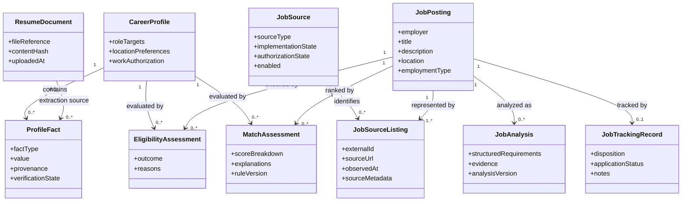

# Domain Model

## Core Domain Concepts

The domain supports a single candidate who imports job opportunities, reviews evidence-based analysis, and records decisions. It distinguishes user-verified career facts from extracted or AI-inferred information and distinguishes a normalized job posting from each source's listing of that posting.

## Entity Responsibilities

### CareerProfile

Represents a candidate's verified professional profile and configurable job-search preferences, including role targets, professional experience, skills, work authorization, employment types, and location preferences. Profile details are supplied and maintained by the user; documentation does not prescribe or disclose a specific candidate's personal facts.

### ProfileFact

Represents an individual career claim, such as a skill or experience. It records provenance and verification state so extracted or AI-inferred claims are not silently treated as verified professional history. Only verified facts should be used as confirmed candidate evidence in matching.

### ResumeDocument

Represents the one existing original resume and its metadata, such as file reference, upload time, and content hash. The original file is preserved unchanged. Extraction results do not overwrite or regenerate it. Customized resumes and generated DOCX/PDF files are out of MVP scope.

### JobSource

Represents a source identity: Adzuna, Greenhouse, Lever, LinkedIn, Indeed, or Manual Import. Source identity is separate from whether an adapter is implemented, authorized, or enabled. LinkedIn and Indeed remain first-class sources even when automated access is unavailable or unauthorized.

### JobSourceListing

Represents a particular source's record or reference to a job, including external identifier when available, source URL, observed time, and source-specific metadata. Multiple listings may refer to one normalized posting. A manual import is also represented with manual provenance.

### JobPosting

Represents the normalized job opportunity, including employer, title, description, location, remote eligibility, employment type, compensation when available, and posting information. It is the shared record against which analysis and tracking are associated.

### JobAnalysis

Represents structured job-description analysis, including extracted requirements, skills, seniority, work location, employment type, compensation, and sponsorship language. It should retain the evidence or text locations supporting important extracted fields and analysis version metadata. AI output is analysis, not verified candidate information.

### EligibilityAssessment

Represents deterministic checks for non-negotiable constraints, such as work authorization, location eligibility, and target job type. Outcomes should distinguish `Eligible`, `Ineligible`, and `NeedsReview`. Ambiguous or missing evidence must not be resolved by an LLM guess.

### MatchAssessment

Represents explainable ranking dimensions and their supporting evidence, such as skills, seniority, location, compensation, and resume/profile relevance. It records the scoring-rule version. Unknown data remains visible rather than being silently scored as a positive match.

### JobTrackingRecord

Represents the candidate's disposition and progress for a job, such as saved, interested, rejected, or application status, along with notes and timestamps. Application actions remain subject to human approval; no automatic submission is in scope.

## Relationships

- A CareerProfile has many ProfileFacts.
- A ResumeDocument may provide source material for extracted ProfileFacts, but does not itself make them verified.
- A JobSource has many JobSourceListings.
- A JobPosting can have multiple JobSourceListings when sources refer to the same opportunity.
- A JobPosting can have analyses and match assessments over time as inputs or rule versions change.
- An EligibilityAssessment and MatchAssessment evaluate a JobPosting against a CareerProfile and its verified facts.
- A JobTrackingRecord records the single user's decision for a JobPosting.

## Job Source Identity and Deduplication

Keep source-specific identity in JobSourceListing rather than embedding provider identifiers into the normalized JobPosting. Where a source supplies a stable external identifier, uniqueness should be scoped to that source. A canonical URL may be used as a secondary identity signal after safe normalization.

Deduplication should be conservative. Matching source identifiers or canonical URLs are strong signals; employer, title, location, and description similarity can support review but should not automatically merge unrelated vacancies. Preserve separate listings and their provenance even when they point to the same normalized posting. Manual imports may lack reliable identifiers and should not be merged on title alone.

## Matching and Eligibility

Eligibility is a deterministic gate, separate from ranking. Sponsorship requirements and work-location constraints are not LLM decisions. Compare any stated sponsorship requirement against the candidate profile's verified work-authorization facts and applicable constraints; absent or ambiguous sponsorship language should be flagged for review rather than assumed compatible.

After eligibility is assessed, ranking explains the relative fit. The candidate's location preferences are configurable; the default priority pattern is:

1. Opportunities in the candidate's configured primary location or region.
2. Relocation opportunities within the candidate's configured relocation area.
3. Remote opportunities available to the candidate at their configured residence.

Remote jobs must explicitly be eligible for the candidate's configured residence or otherwise satisfy the candidate's U.S. work-location requirements. A remote label alone is insufficient evidence. Target employment types are full-time and contract. Any unavailable or ambiguous job data should remain visible in the assessment.

Matching combines deterministic rules with AI-assisted structured extraction and analysis. AI can identify requirements and provide evidence-based relevance analysis, but must not fabricate skills, determine hard eligibility independently, or change verified profile facts.

## Domain Diagram

