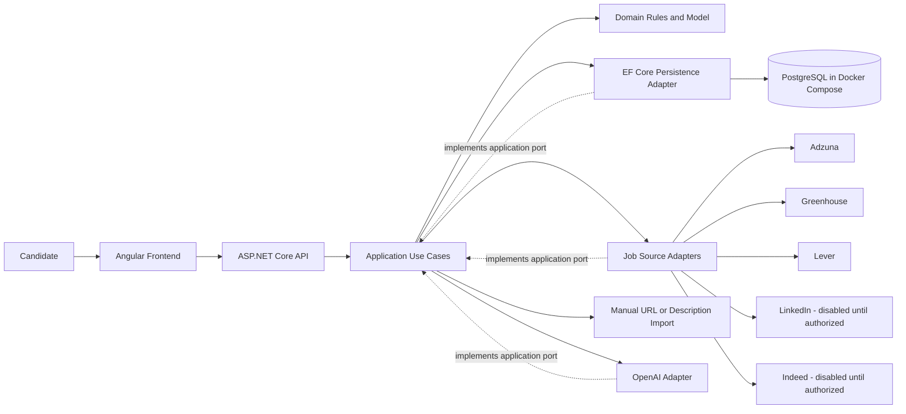

# System Architecture

## Purpose and Scope

AI Job Hunter Agent is planned as a local-first, single-user application for importing job opportunities, analyzing them against a verified career profile, ranking them transparently, and supporting human-led application decisions. The MVP uses on-demand processing; it does not include scheduled background processing or automatic application submission.

## System Context

The candidate uses an independent Angular application to manage a professional profile, import jobs, review analysis, and track decisions. The Angular application communicates with an ASP.NET Core Web API. The API coordinates application use cases and uses PostgreSQL for persistence. It may call the OpenAI API for structured analysis and permitted job-source integrations for discovery or posting retrieval.

Manual URL and description import remain supported when automated source access is unavailable or not authorized. A manual URL import does not imply automated page fetching. LinkedIn and Indeed are first-class architectural sources, but the design does not claim that automated access is currently available or authorized.

## Logical Components

### Angular Frontend

- Independent frontend application built with Angular and TypeScript.
- Presents profile, import, analysis, matching, and tracking workflows.
- Does not hold provider credentials or call OpenAI directly.

### ASP.NET Core API

- Exposes application workflows to the frontend.
- Validates input and maps application results to HTTP responses.
- Does not own domain decisions that belong in the domain or application layers.

### Application Layer

- Coordinates use cases such as importing a job, analyzing a description, calculating a match, and updating tracking state.
- Defines ports for persistence, job-source providers, AI analysis, and resume parsing.
- Orchestrates deterministic eligibility and scoring around AI-derived structured information.

### Domain Layer

- Owns core concepts, invariants, status transitions, and deterministic eligibility/matching rules.
- Has no dependency on ASP.NET Core, EF Core, OpenAI libraries, or provider-specific SDKs.

### Infrastructure and Integrations

- Infrastructure implements persistence and file-storage needs using PostgreSQL and EF Core.
- Integration adapters encapsulate OpenAI and each job source's protocol, configuration, and data mapping.
- Provider responses are mapped into application/domain concepts at the boundary.

### PostgreSQL

- Stores profile facts, job postings and source listings, analyses, match assessments, and tracking records.
- Runs in Docker Compose for local development.

## Dependency Direction

Dependencies point inward:

1. The Domain depends on no outer application or infrastructure layer.
2. The Application depends on Domain and defines interfaces for external capabilities.
3. Infrastructure and Integrations implement Application interfaces and may depend on Domain types.
4. The API is an outer composition and transport boundary that invokes Application use cases.
5. The Angular application communicates with the API over HTTP and is not a .NET project dependency.

Runtime calls may flow from the API/Application layer to interfaces implemented by integrations or infrastructure. Compile-time dependencies should not make Domain depend on those implementations.

## Integration Boundaries

### Job Sources

Adzuna, Greenhouse, Lever, LinkedIn, and Indeed are represented as independent source identities. Each provider adapter is isolated so credentials, access state, limits, response formats, and errors do not leak into the domain. Implementation state and authorization state are separate: being represented or implemented does not mean a provider is enabled or authorized.

Where automated access is not available or permitted, users can enter a URL or paste a job description. Imported data records its provenance. Current access permissions and terms must be verified before an adapter is enabled; no scraping, access-control bypass, or prohibited automation is assumed.

### OpenAI

An application-owned AI interface isolates OpenAI-specific requests and response handling. Structured output is validated before use. The model analyzes descriptions and supports evidence-based relevance analysis; deterministic application/domain rules control hard eligibility and ranking. No application action is delegated to the model.

### Resume Parsing and Persistence

Resume parsing is behind an application boundary so the extraction mechanism can be changed without changing domain policy. The original user-provided resume is preserved unchanged; extracted information is reviewable and must be verified before it is treated as a career-profile fact.

## Runtime and Docker Strategy

- Docker Compose runs PostgreSQL with persistent local storage for development.
- Initially, run the API and Angular application from the developer environment; containerizing them is optional and should be justified by onboarding or deployment needs.
- Keep database ports local to the development machine where practical. Do not expose PostgreSQL publicly.
- Keep credentials and API keys out of source control and frontend bundles.
- Use explicit EF Core migrations and document the development workflow when implementation begins.
- Redis, RabbitMQ, and a separate Worker project are not part of the MVP.

## Architecture Diagram

The diagram shows logical relationships, not a deployment topology. External source adapters are enabled only after their intended use and access have been verified.
